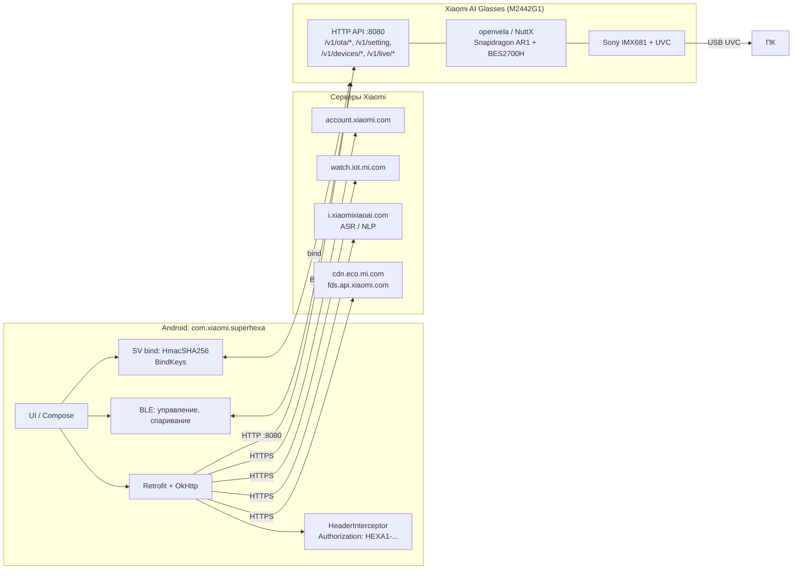

# Xiaomi AI Glasses (M2442G1) — исследование прошивки и локального API

> Репозиторий с результатами реверс-инжиниринга очков **Xiaomi AI Glasses (модель M2442G1)**:
> что за железо и ОС внутри, почему «просто перепрошить» не выйдет, где у устройства
> локальный HTTP API, и как устроена схема подписи запросов `HEXA1-HMAC-SHA256`.
>
> Всё сделано на **своём** устройстве и на **публично доступном** APK официального
> приложения. Очки не вскрывались, прошивка не заливалась, ничего не «кирпичилось».

---

## Содержание

1. [TL;DR — что найдено](#1-tldr--что-найдено)
2. [Дисклеймер и границы работы](#2-дисклеймер-и-границы-работы)
3. [Устройство: что внутри](#3-устройство-что-внутри)
4. [Три мифа, которые надо закрыть сразу](#4-три-мифа-которые-надо-закрыть-сразу)
5. [Хронология работы — по шагам](#5-хронология-работы--по-шагам)
6. [Архитектура связи «телефон ↔ очки»](#6-архитектура-связи-телефон--очки)
7. [Локальный API очков (порт 8080)](#7-локальный-api-очков-порт-8080)
8. [Схема подписи HEXA1 — полностью восстановлена](#8-схема-подписи-hexa1--полностью-восстановлена)
9. [Что уже работает и что осталось](#9-что-уже-работает-и-что-осталось)
10. [Roadmap](#10-roadmap)
11. [Как воспроизвести](#11-как-воспроизвести)
12. [Структура репозитория](#12-структура-репозитория)
13. [FAQ](#13-faq)
14. [Этика, право, безопасность](#14-этика-право-безопасность)
15. [Ссылки и источники](#15-ссылки-и-источники)

---

## 1. TL;DR — что найдено

| Вопрос | Ответ |
|---|---|
| Что за устройство | Xiaomi AI Glasses, модель **M2442G1**, очки с камерой и AI-ассистентом |
| Что за ОС | **openvela** (Xiaomi Vela, RTOS на базе NuttX) — **не Android** |
| Есть ли ADB | Был получен исследователем через уязвимость, Xiaomi **закрыла** в новых прошивках |
| Есть ли публичная прошивка | **Нет.** В архиве прошивок Xiaomi 56 устройств — только браслеты и часы |
| Есть ли канал управления | **Да.** Локальный HTTP API очков на **порту 8080** |
| Что в API | OTA-загрузка, настройки, чувствительность датчика ношения, live-стрим, файлы |
| Как защищён API | Заголовок `Authorization: HEXA1-HMAC-SHA256 ...` |
| Схема подписи | **Восстановлена полностью** (алгоритм + захардкоженный `serviceToken`) |
| Готовый код | `tools/hexa_sign.py` (генератор подписи), `tools/probe.py` (пробник API) |
| Что мешает сейчас | У тестового ПК **нет Wi-Fi адаптера** — к точке доступа очков не подключиться |

**Главный вывод:** «дверь» в устройство существует, но это не ADB и не fastboot,
а локальный REST API с подписью. Подпись мы разобрали. Дальше нужен только сетевой доступ.

---

## 2. Дисклеймер и границы работы

**Что делалось:**
- инвентаризация USB-устройств на своём ПК;
- чтение публичной документации и публичных репозиториев;
- скачивание **официального** APK с CDN Xiaomi и его статический анализ;
- дизассемблирование DEX-файлов через `androguard`;
- написание генератора подписи и пробника API.

**Что НЕ делалось:**
- очки не вскрывались;
- прошивка не заливалась и не модифицировалась;
- `uploadOtaFile` не вызывался;
- никакие чужие аккаунты и устройства не затрагивались.

**Риски, которые надо понимать:**
- вызов `POST /v1/ota/uploadOtaFile/` с непроверенным образом — потенциальный кирпич;
- восстановления после неудачной прошивки у этой модели **нет** (нет EDL/fastboot/recovery);
- любые записи в устройство (`/v1/setting`, `/v1/change`, `/v1/resetting`) могут
  изменить состояние очков — начинать надо только с `GET`.

---

## 3. Устройство: что внутри

### 3.1. Паспортные данные

| Параметр | Значение |
|---|---|
| Модель | **M2442G1** |
| Масса | 40 г без линз (45 г с простыми линзами по замерам) |
| Защита | IP54 |
| Камера | 12 МП, **Sony IMX681** |
| Видео | **2304 × 1728** (~4 МП, маркетинговое «2K»), 30 fps, EIS |
| Аудио | два open-ear динамика, 5 микрофонов, шумоподавление ветра |
| Батарея | 263 мАч (кремний-углеродный анод) |
| Связь | Bluetooth 5.4, Wi-Fi 6 (5 ГГц) |
| Дисплей | отсутствует, весь вывод — звук |
| Цена на старте | 1999 юаней (Китай, июнь 2025) |

### 3.2. Кремний (по данным вскрытий)

| Компонент | Роль |
|---|---|
| **Qualcomm Snapdragon AR1** | основной SoC: камера, ISP, AI-инференс, Wi-Fi |
| **Bestechnic BES2700H** | маломощный компаньон: Bluetooth-аудио |
| **Qualcomm WCN7851** | Wi-Fi 6 |
| **Kingston ePoP** | DRAM + flash в одном BGA-корпусе |

Важно: **BES2700H — это не главный процессор**, а аудио-компаньон. Поэтому методики
взлома браслетов на BES (Mi Band 9/10) напрямую к очкам не применимы: камера,
система и secure boot живут на AR1.

### 3.3. Что видит Windows при подключении по USB

```
Класс:      Camera
Имя:        UVC Camera
InstanceId: USB\VID_2717&PID_50BD&MI_00\...
Драйвер:    usbvideo (USB Video Device)
HardwareID: USB\VID_2717&PID_50BD&REV_0510
BusReportedDeviceDesc:
            MAC:04:34:C3:4F:01:8C-Xiaomi AI Glasses 018C
Серийный:   63791/DYAMJQ5WA00105
```

Устройство составное (`usbccgp`), но внутри **ровно один функциональный интерфейс** —
`MI_00`, класс `0x0e` (UVC-камера). Ни ADB-интерфейса, ни CDC/serial, ни vendor-канала
через USB нет. То есть по кабелю очки отдают только видеопоток.

### 3.4. Прошивка: что известно

- ОС: **openvela** — открытая версия Xiaomi Vela (NuttX RTOS).
- Известные версии: `1.2.31.0` (сентябрь 2025, Alipay «взгляд-оплата»),
  `1.3.13.0` (октябрь 2025, Bilibili-стрим, hands-free звонки, проверка качества кадра).
- В `1.3.13.0` Xiaomi **исправила баг «неограниченной длительности записи»**:
  если не выбирать длительность вручную, лимита не было.
- Настройка длительности фрагмента в приложении: **15 с, 1, 2, 3, 5, 10 минут**.
- Проверка «LED закрыт» использует камеру + датчик освещённости + датчик приближения
  и **принудительно выключает камеру**.

---

## 4. Три мифа, которые надо закрыть сразу

### Миф 1. «Это же обычный процессор, значит можно перепрошить как телефон»

Процессор действительно обычный ARM. Но перепрошивка требует трёх вещей:

1. **Режим прошивки** — у телефона есть fastboot/recovery/EDL, у очков нет ни одного.
2. **Образ, который примет загрузчик** — secure boot Snapdragon AR1 проверяет подпись,
   ключи только у Xiaomi.
3. **Документация на плату** — BSP, карта памяти, периферия. Публично отсутствует.

Нет ни одного из трёх.

### Миф 2. «На openvela ничего не прошивают, это же RTOS»

Неправда. Mi Band 8/9/10 работают на **той же Vela/NuttX**, и их прошивают:
`atc1441/ATCmiBand8fw`, `atc1441/MiBand10-BES2700iMP-BEST1503-Hacking` (там даже DOOM
запущен на 36 FPS). Разница не в ОС, а в наличии: канала записи, обхода подписи,
размера сообщества и утёкших SDK/загрузчиков.

### Миф 3. «Раз есть API — можно залить свою прошивку»

API для загрузки есть (`/v1/ota/uploadOtaFile/`), но:
- самого образа прошивки в публичном доступе **нет**;
- на устройстве есть проверка контрольной суммы (`checkFileByCheckSum`), вероятно и подписи;
- неудачная заливка = кирпич без восстановления.

Поэтому работа с API начинается с **чтения**, а не с записи.

---

## 5. Хронология работы — по шагам

Ниже — что реально было сделано, с командами и результатами. Шаги можно повторять.

### Шаг 1. Инвентаризация USB

```powershell
Get-PnpDevice -PresentOnly |
  Where-Object { $_.Class -in @('Camera','Image','USB','Media') } |
  Select-Object Class, FriendlyName, Status, InstanceId
```

Результат: найдено `UVC Camera`, `VID_2717&PID_50BD`, статус OK.

### Шаг 2. Идентификация устройства

```powershell
Get-PnpDeviceProperty -InstanceId 'USB\VID_2717&PID_50BD\...' |
  Where-Object { $_.KeyName -match 'BusReportedDeviceDesc|Service|HardwareIds' }
```

Результат: `BusReportedDeviceDesc = MAC:...-Xiaomi AI Glasses 018C`,
`Service = usbvideo`. Стало понятно, что это очки, а не веб-камера.

### Шаг 3. Проверка: есть ли публичная прошивка

Проверены:
- GitHub-поиск по «Xiaomi AI Glasses» — 3 репозитория, ни одного с прошивкой;
- архив прошивок `AstralSightStudios/MiWearFirmwareArchives` и его зеркало
  `hrk666666/firmware-archives-public` — **56 устройств**, все `*.watch.*`
  (браслеты и часы), очков нет;
- китайские источники по модели `M2442G1` — только обзоры и вопросы, образов нет.

**Вывод:** публичного образа прошивки не существует.

### Шаг 4. Проверка ADB-пути

Изучен проект `idootop/MigicCube`. Автор в issue #1 пишет:

> «I originally got ADB access on these glasses through extensive reverse-engineering work.
> I found and exploited a vulnerability to enable it. I later reported the vulnerability to
> Xiaomi, and they've since patched it. I can no longer get ADB access on newer firmware builds.»

То есть ADB на очках существует, но в рознице выключен, а дыра закрыта.
Дополнительно: в коде MigicCube команды `am broadcast`, `dumpsys`, `logcat`,
`/storage/emulated/0/DCIM` относятся к **телефону**, а не к очкам.

**Вывод:** ADB-путь для нового устройства закрыт.

### Шаг 5. Скачивание официального APK

Приложение: **`com.xiaomi.superhexa`** («Xiaomi Glasses»).

Официальная страница-редирект:
`https://cnbj1.fds.api.xiaomi.com/camera-glasses-fds/andriod/andriod_download.html`

Прямая ссылка на APK (из JS страницы):
```
https://cnbj1.fds.api.xiaomi.com/camera-glasses-fds/andriod/eco-andriod-glass.apk
```

Факты о файле:

| Параметр | Значение |
|---|---|
| Размер | **402 681 690** байт |
| Last-Modified | Thu, 12 Feb 2026 03:51:38 GMT |
| SHA-256 (скачанного файла) | `CFB86B4A886015EF75297646609C41FBD0E5A0069F8D68610EC6282F3EA68A00` |
| Версия в APKPure | 3.1.0i (XAPK 103.3 МБ, SHA-256 `f51233ad...`) |

Скачивание:

```powershell
curl.exe -L --retry 2 -o glasses.apk `
  "https://cnbj1.fds.api.xiaomi.com/camera-glasses-fds/andriod/eco-andriod-glass.apk"
Get-FileHash .\glasses.apk -Algorithm SHA256
```

### Шаг 6. Структура APK

APK — это ZIP. Внутри: **4768 записей**, **17 dex-файлов**, тяжёлые нативные библиотеки.

Крупнейшее:

| Размер | Файл |
|---|---|
| 65 237 904 | `lib/arm64-v8a/libarcsoft_facialrestoration.so` |
| 37 580 672 | `lib/arm64-v8a/libarcsoft_supernight.so` |
| 33 507 056 | `lib/arm64-v8a/libeffect.so` |
| 13 196 900 | `classes.dex` |
| 9 989 386 | `assets/EffectResource/ILAModels.bundle/...` |

В `assets/dist/` лежит React-фронтенд (H5-часть приложения).

### Шаг 7. Поиск сетевых адресов и эндпоинтов

Из всех dex извлечены строки и URL-паттерны:

- **468 уникальных URL** по dex-файлам, ~60 хостов;
- среди них: `account.xiaomi.com`, `watch.iot.mi.com`, `cdn.eco.mi.com`,
  `i.xiaomixiaoai.com`, `speech/nlp.xiaomixiaoai.com`, `apmplus.volces.com`;
- **найдено 79 путей `/v1/...`**;
- критично: **`http://%s:8080/v1/...`** — локальный API очков.

Ключевые находки:

```
http://%s:8080/v1/ota/uploadOtaFile/
http://%s:8080/v1/ota/checkOtaStatus/
http://%s:8080/v1/ota_package
http://%s:8080/v1/devices/wearDetection/sensitivities
http://%s:8080/v1/live/{deviceId}/config
```

**Вывод:** очки поднимают HTTP-сервер на порту 8080, приложение ходит в него напрямую.

### Шаг 8. Реверс схемы подписи

Поиск по dex показал: строка `HEXA1-HMAC-SHA256 nonce=%s, timestamp=%s, signature=%s`
живёт в `classes5.dex`, а `HmacSHA256` — в `classes4.dex`.

Через `androguard` (без Java) дизассемблированы классы:

- `com.superhexa.supervision.library.net.retrofit.CredentialCalculator`
  — сборка строки credential;
- `com.superhexa.supervision.library.base.basecommon.tools.d0`
  — сам HMAC;
- `com.superhexa.supervision.library.base.basecommon.tools.ExtensionsKt`
  — конвертация байт в hex (`%02x`);
- `com.superhexa.supervision.library.net.retrofit.interceptor.b`
  — интерцептор, который кладёт результат в заголовок **`Authorization`**.

Подробный разбор smali — в [`docs/hexa1-signing.md`](docs/hexa1-signing.md).

### Шаг 9. Реализация генератора подписи

Написан `tools/hexa_sign.py`. Пример детерминированного прогона
(`ts=1700000000000`, `rand=1234`):

```
key used     : f7b364516e739c2ac60f1114e88f6afc
signed text  : nonce=d797018352a2731345a285fd3e0c055d&timestamp=1700000000000
credential   : HEXA1-HMAC-SHA256 nonce=d797018352a2731345a285fd3e0c055d,
               timestamp=1700000000000,
               signature=797b76fc2ed4379460f076ff4cab71044add4387a49f3e5b739eccbb87a9c2d7
```

### Шаг 10. Пробник API

Написан `tools/probe.py`:

- генерирует подпись;
- добавляет `Authorization`, `X-Request-ID`, `X-App-Version`;
- делает `GET` на read-only эндпоинты;
- отдельно повторяет запрос **без** подписи для сравнения кодов ответа;
- умеет `--scan` по типовым адресам шлюзов.

### Шаг 11. Блокер: нет Wi-Fi

```
Get-NetAdapter
  Radmin VPN    Up
  outline-tap0  Disconnected
  Ethernet      Up   192.168.0.130
```

Wi-Fi адаптера в системе нет, `wlansvc` остановлен. Очки — точка доступа,
значит подключиться к их сети с этого ПК невозможно. На этом работа остановлена.

---

## 6. Архитектура связи «телефон ↔ очки»



Ключевой момент: **у очков два независимых канала** —
локальный HTTP (порт 8080) и BLE/SPP. Локальный HTTP используется для файлов,
настроек, live-стрима и OTA; BLE — для управления и спаривания.

---

## 7. Локальный API очков (порт 8080)

Базовый адрес: `http://<ip-очков>:8080`. Очки выступают точкой доступа Wi-Fi,
поэтому IP — обычно шлюз этой сети.

### 7.1. Эндпоинты, найденные в APK

| Метод/путь | Назначение |
|---|---|
| `POST /v1/ota/uploadOtaFile/` | **загрузка файла прошивки** |
| `GET /v1/ota/checkOtaStatus/` | статус OTA |
| `/v1/ota/packages` | список пакетов |
| `/v1/ota_package` | пакет OTA |
| `/v1/devices/wearDetection/sensitivities` | **чувствительность датчика ношения** |
| `/v1/devices/glassesFrame` | данные оправы |
| `/v1/devices/{deviceId}` | карточка устройства |
| `/v1/devices/{deviceId}/backups/security` | бэкап настроек безопасности |
| `/v1/deviceNetState/` | состояние сети |
| `/v1/live/{deviceId}/config` | конфиг live-стрима |
| `/v1/live/{deviceId}/info` | информация о стриме |
| `/v1/live/{deviceId}/status` | статус стрима |
| `/v1/fileTransfer` | передача файлов |
| `/v1/filelists` | списки файлов |
| `/v1/files/{name}` | файл по имени |
| `/v1/file/upload` | загрузка файла |
| `/v1/rawImage/{id}` | сырое изображение |
| `/v1/setting` | настройки |
| `/v1/change` | изменение настроек |
| `/v1/resetting` | сброс |
| `/v1/login`, `/v1/token`, `/v1/otp`, `/v1/logout` | авторизация |
| `/v1/pointLog` | лог точек |
| `/v1/devices/stackTraces` | стек-трейсы устройства |

> Часть путей (`/v1/devices/...`, `/v1/live/...`) встречается и в облачных
> интерфейсах Xiaomi. Принадлежность к локальному API определяется по префиксу
> `http://%s:8080`, который в APK стоит именно у OTA-вызовов.

### 7.2. Заголовки, которые шлёт приложение

| Заголовок | Значение |
|---|---|
| `Authorization` | `HEXA1-HMAC-SHA256 nonce=..., timestamp=..., signature=...` |
| `X-Request-ID` | `App_Android_<ts>_<hashCode>` (hash от строки с рандомом) |
| `X-Mobile-Id` | идентификатор мобильного клиента |
| `X-App-Version` | `Android:<versionName>` |
| `Accept-Language` | язык системы |
| `Content-Type` | `application/json` (если не задан) |

Интерцептор **не перезаписывает** уже установленный `Authorization`
и пропускает подпись для хостов `fds.api.xiaomi.com`.

---

## 8. Схема подписи HEXA1 — полностью восстановлена

### 8.1. Псевдокод

```
ts        = currentTimeMillis()                     # миллисекунды
r         = random(0..10000)
nonce     = md5_hex(ts + r)                         # 32 символа, padStart('0')
timestamp = str(ts)

если body пустой:
    text = "nonce={nonce}&timestamp={timestamp}"
иначе если метод GET:
    text = "{body}&nonce={nonce}&timestamp={timestamp}"
иначе (POST):
    text = "data={body}&nonce={nonce}&timestamp={timestamp}"

passToken = token_for_host(host)
key       = serviceToken                  если passToken пуст
          = serviceToken + passToken      иначе

signature = hex_lower(HMAC_SHA256(key, text))

header    = "HEXA1-HMAC-SHA256 nonce={nonce}, timestamp={timestamp}, signature={signature}"
```

### 8.2. Константы и источники

| Что | Значение / источник |
|---|---|
| `serviceToken` (default) | `f7b364516e739c2ac60f1114e88f6afc` |
| Хэш для nonce | MD5 |
| HMAC | `HmacSHA256` |
| Кодировка вывода | hex, lowercase (`%02x`) |
| Заголовок | `Authorization` |
| `passToken` для `device.eco.mi.com`, `device-eco.test.mi.com`, `asp.mi.com`, `*fds.api.xiaomi.com*` | `miWearServiceToken` |
| `passToken` для остальных хостов (в т.ч. локальный IP) | `AccountInfo.passToken` из аккаунта Xiaomi |

### 8.3. Готовый код

`tools/hexa_sign.py` — без зависимостей, только стандартная библиотека:

```python
from hexa_sign import make_credential

cred, dbg = make_credential(pass_token="", post_parameter="", http_type="GET")
print(cred)
# HEXA1-HMAC-SHA256 nonce=..., timestamp=..., signature=...
```

### 8.4. Что это даёт

- Можно формировать корректно подписанные запросы к локальному API.
- Если для локального хоста `passToken` пуст — ключ равен захардкоженному
  `serviceToken`, и подпись сходится без аккаунта.
- Если `passToken` не пуст — нужен токен **своего** аккаунта Xiaomi
  (он лежит в `AccountInfo` на телефоне).

---

## 9. Что уже работает и что осталось

### Работает

| Компонент | Статус |
|---|---|
| Генератор подписи `HEXA1` | ✅ реализован, детерминированный тест проходит |
| Пробник API | ✅ реализован, ждёт сетевого доступа |
| Карта эндпоинтов | ✅ собрана из APK |
| Понимание OTA-канала | ✅ найдены upload/status/packages |
| Чтение UVC-потока с ПК | ✅ работает (очки определяются как камера) |

### Не проверено (нужен доступ к сети очков)

- отвечает ли API на подпись с одним `serviceToken`;
- требуется ли `passToken`;
- какие поля принимает `/v1/devices/wearDetection/sensitivities`;
- отдаёт ли `/v1/setting` список настроек записи (длительность, качество).

### Не сделано и почему

- **Образ прошивки** — публично отсутствует.
- **Модификация прошивки** — нет образа, нет канала записи, есть проверка целостности.
- **ADB** — уязвимость закрыта Xiaomi.

---

## 10. Roadmap

### Этап 1. Сетевой доступ (сегодня-завтра)

- [ ] Подключить ПК к точке доступа очков (USB Wi-Fi адаптер / телефон + Termux / ноутбук).
- [ ] Найти IP очков: `python tools/probe.py --scan`.
- [ ] Проверить `GET /v1/setting` с подписью.
- [ ] Сравнить с запросом без подписи (ожидаем 401/403).

### Этап 2. Чтение настроек

- [ ] `GET /v1/devices/wearDetection/sensitivities` — какие уровни есть.
- [ ] `GET /v1/setting` — полный дамп настроек.
- [ ] `GET /v1/deviceNetState/` — состояние сети.

### Этап 3. Аккуратная запись

- [ ] Понять формат `PUT/POST` для чувствительности ношения.
- [ ] Проверить, можно ли менять длительность записи (осторожно, только после чтения).
- [ ] Вести лог каждого изменения, чтобы можно было откатить.

### Этап 4. OTA (только при наличии образа)

- [ ] Получить официальный OTA-пакет (перехват трафика приложения или запрос к CDN).
- [ ] Разобрать формат: шифрование, подпись, разбиение на чанки.
- [ ] Проверить `checkFileByCheckSum` на **копии** файла, не на устройстве.
- [ ] Только потом думать про `uploadOtaFile` — с полным пониманием риска кирпича.

---

## 11. Как воспроизвести

### 11.1. Требования

- Windows/Linux/macOS;
- Python 3.10+ (проверено на 3.12);
- `androguard` для анализа APK (опционально);
- ~1 ГБ свободного места (APK 400 МБ + распакованные dex).

### 11.2. Установка

```bash
python -m pip install androguard
```

### 11.3. Скачивание APK

```bash
curl -L --retry 2 -o glasses.apk \
  "https://cnbj1.fds.api.xiaomi.com/camera-glasses-fds/andriod/eco-andriod-glass.apk"
```

Проверка целостности:

```bash
sha256sum glasses.apk
# ожидается CFB86B4A886015EF75297646609C41FBD0E5A0069F8D68610EC6282F3EA68A00
```

### 11.4. Анализ APK

```bash
python tools/apk_scan.py glasses.apk
```

Скрипт выведет: число записей, крупнейшие файлы, список dex, все URL, хосты,
`/v1/`-эндпоинты и строки, связанные с OTA.

### 11.5. Проверка генератора подписи

```bash
python tools/hexa_sign.py
```

### 11.6. Пробник API

```bash
# если знаешь IP очков
python tools/probe.py 192.168.43.1

# если не знаешь — поиск по типовым шлюзам
python tools/probe.py --scan

# если требуется passToken своего аккаунта
python tools/probe.py 192.168.43.1 --pass-token <TOKEN>
```

---

## 12. Структура репозитория

```
xiaomi-ai-glasses-research/
├── README.md                     ← этот файл
├── LICENSE
├── .gitignore
├── docs/
│   ├── hardware.md               ← железо, ОС, почему прошивка сложна
│   ├── apk-analysis.md           ← как разбирался APK
│   ├── device-api.md             ← карта локального API
│   └── hexa1-signing.md          ← полный разбор подписи со smali
├── tools/
│   ├── hexa_sign.py              ← генератор HEXA1 credential
│   ├── probe.py                  ← пробник API очков
│   └── apk_scan.py               ← статический анализ APK
└── data/
    └── findings.json             ← машиночитаемая сводка находок
```

---

## 13. FAQ

**Это точно не Android?**
Да. openvela/NuttX. APK на очках не запускается — APK это формат Android.

**А почему тогда в APK есть `am`, `dumpsys`, `logcat`?**
Это команды для **телефона**. Проект MigicCube дёргает приложение на смартфоне,
а не очки.

**Можно ли поставить туда своё приложение?**
Нет. Нет ни среды исполнения APK, ни публичного способа записи.

**А часы же прошивают?**
Прошивают. Но там есть канал (UART/тестовые пятаки), утёкшие SDK и загрузчики,
и огромное сообщество. У очков ничего из этого нет.

**Подпись — это взлом?**
Нет. Это разбор публичного APK: константа и алгоритм лежат в открытом файле.

**Почему нельзя просто залить свою прошивку через `uploadOtaFile`?**
Нет образа; на устройстве проверка целостности; ошибка = кирпич без восстановления.

**Что делать, если очень хочется 20 минут записи?**
Сейчас лимит — параметр, который присылает приложение (пресеты до 10 минут).
Теоретически кастомный клиент может попробовать другое значение, но после
прошивки 1.3.13.0 устройство, скорее всего, ограничивает его само.
Безопасная альтернатива — писать видео на ПК через UVC.

---

## 14. Этика, право, безопасность

- Всё исследование — на **своём** устройстве и **своём** аккаунте.
- `serviceToken` — константа из публично распространяемого APK, не пользовательский секрет.
- **Никогда** не коммитьте в репозиторий реальные `passToken`, cookies, аккаунтные токены.
  Для этого есть `.gitignore`.
- Обход индикатора записи (LED) — это не «лайфхак», а содействие скрытой съёмке.
  В этом репозитории таких инструкций нет и не будет.
- Заливка модифицированной прошивки может нарушать условия эксплуатации устройства
  и лишить гарантии.

---

## 15. Ссылки и источники

### Устройство и обзоры

- AI Wiki — Xiaomi AI Glasses: https://aiwiki.ai/wiki/xiaomi_ai_glasses
- TechInsights — teardown M2442G1: https://www.techinsights.com/blog/summary-xiaomi-ai-glasses-m2442g1-deep-dive-teardown
- iFixit/52audio — разбор: https://www.52audio.com/archives/245045.html
- GSMArena — анонс: https://www.gsmarena.com/xiaomi_ai_glasses_debut_with_2k_recording_and_over_8_hours_of_battery_life_openwear_stereo_pro_offer-news-68416.php

### ОС и экосистема

- openvela (исходники): https://github.com/open-vela
- OpenWearWiki — гайд по Vela: https://yizigezi.github.io/OpenWearWiki/vela-developer-guide.html

### Прошивки и моды

- Архив прошивок Xiaomi: https://github.com/AstralSightStudios/MiWearFirmwareArchives
- Зеркало архива: https://github.com/hrk666666/firmware-archives-public
- Mi Band 8 custom firmware: https://github.com/atc1441/ATCmiBand8fw
- Mi Band 9/10 (BES2700iMP) hacking: https://github.com/atc1441/MiBand10-BES2700iMP-BEST1503-Hacking
- MigicCube (ADB-исследование очков): https://github.com/idootop/MigicCube
- Мод APK компаньона: https://github.com/jacuboffsky/xiaomi-glasses-network-fix

### Приложение

- Официальная страница загрузки: https://cnbj1.fds.api.xiaomi.com/camera-glasses-fds/andriod/andriod_download.html
- APKPure: https://apkpure.com/xiaomi-glasses/com.xiaomi.superhexa

### Инструменты

- androguard: https://github.com/androguard/androguard
- jadx: https://github.com/skylot/jadx
